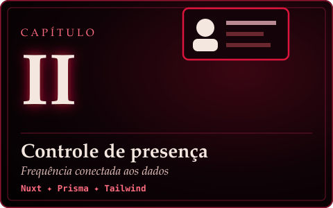

  

  
Do frontend ao backend, construindo aplicações e evoluindo a cada projeto.

  
Cada raio deste eclipse é um dia real de código. Se eu parar de escrever, ele apaga.

  
  

## / Sobre mim

Sou **Gabriel Ferreira**, desenvolvedor com foco em **evoluir no desenvolvimento full stack**. Construo aplicações web conectando interfaces, APIs, regras de negócio e bancos de dados para resolver problemas do dia a dia.

**Desenvolvo a maioria dos meus projetos de forma independente**, trabalhando nas diferentes etapas da aplicação: entendimento do problema, construção das telas, implementação do backend e integração com os dados. Também participo de projetos colaborativos, onde compartilho decisões e aprendo com outros desenvolvedores.

- **Frontend:** React, Vue/Nuxt, TypeScript e interfaces responsivas.
- **Backend:** PHP/Laravel, rotas de API, autenticação e regras de acesso.
- **Dados e integrações:** SQLite, Prisma, APIs externas e Google Sheets.
- **Meu próximo passo:** aprofundar arquitetura, testes e boas práticas para construir aplicações cada vez mais consistentes e fáceis de manter.

## 🚀 Projetos em destaque

Projetos públicos que mostram minha prática com interfaces, lógica de negócio, dados e integrações.

<table>
<tr>
<td width="50%" valign="top">

Solicitação, aprovação e validação por perfis de usuário, com notificações por e-mail e registro das movimentações.

[Explorar código →](https://github.com/escritor2/autorizacao-digital)

</td>
<td width="50%" valign="top">

Lançamento de presenças e faltas por turma e disciplina, acesso por perfil e integração com o Google Sheets.

[Explorar código →](https://github.com/escritor2/controle-de-presen-a)

</td>
</tr>
<tr>
<td width="50%" valign="top">

Projeto colaborativo de biblioteca digital com catálogo integrado a APIs, leitura de PDF/EPUB e recursos de IA para estudo.

[Explorar código →](https://github.com/escritor2/my-collection-digital)

</td>
<td width="50%" valign="top">

Formulário responsivo para registrar descartes, com edição de linhas, salvamento local, uso offline e exportação em PDF.

[Explorar código →](https://github.com/escritor2/descarte-de-insumos) · [Abrir aplicação ↗](https://descarte-de-insumos.vercel.app)

</td>
</tr>
</table>

<a href="https://github.com/escritor2?tab=repositories"><b>Ver todos os repositórios ↗</b></a>

## 🛠️ Tecnologias presentes nos meus projetos

| Área | Aplicação nos projetos |
| :-- | :-- |
| **Interfaces** | Componentes reutilizáveis, formulários e layouts responsivos. |
| **Backend e dados** | APIs, autenticação, permissões e persistência de dados. |
| **Integrações** | Google Sheets, catálogos de livros, notificações e serviços de IA. |
| **Processos** | Fluxos de aprovação, registros operacionais e acompanhamento de frequência. |

## 📚 Em evolução contínua

Meu foco é fortalecer a visão da aplicação como um todo: entender como o frontend consome uma API, como o backend valida e processa as informações e como os dados são armazenados. Uso meus projetos para praticar essa conexão e aprimorar organização de código, tratamento de erros, testes e documentação.

<b>Isso tudo é real?</b>

 

É. Um script próprio, sem bibliotecas, lê meus dados públicos no GitHub e desenha tudo em SVG. Uma GitHub Action repete isso a cada 3 horas.

| No eclipse | No GitHub |
| :-- | :-- |
| **Raios da coroa** | 364 raios, um por dia do último ano; quanto mais contribuições, mais longo. O traço branco marca hoje. |
| **Anel de texto** | Meus repositórios públicos mexidos mais recentemente. |
| **Feixes de luz** | Contribuições da semana, até 14. |
| **Pulsação** | Acelera conforme a semana fica mais produtiva. |
| **Árvore de Repositórios** | Cada galho é um repositório público; a espessura vem do volume de código de cada linguagem. |
| **Registro** | Cada marca é um dia; a altura muda com a quantidade de contribuições. |
| **Diário** | Minhas últimas mensagens de commit em repositórios públicos. |
| **A pena não para** | Algum dos últimos 3 dias teve 10 contribuições ou mais. |
| **A tinta seca** | De 3 a 13 dias sem contribuir: o eclipse enfraquece. |
| **A pena descansa** | De 14 a 29 dias sem contribuir. |
| **Eclipse total** | 30 dias ou mais: a coroa apaga e os feixes param. |

Código em [`eclipse/`](eclipse/).

## 🤝 Vamos conversar?

Se você está recrutando para desenvolvimento full stack ou quer conversar sobre meus projetos e minha evolução, entre em contato pelo **[LinkedIn](https://www.linkedin.com/in/gabriel-ferreira-2b7ab5250/)**.

   
  
    
  Gabriel Ferreira · <a href="https://github.com/escritor2">@escritor2</a>

